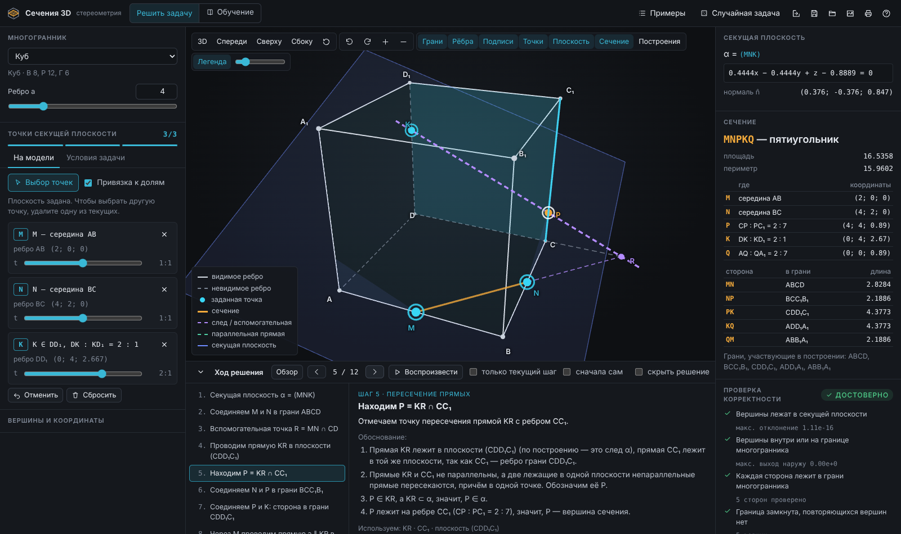
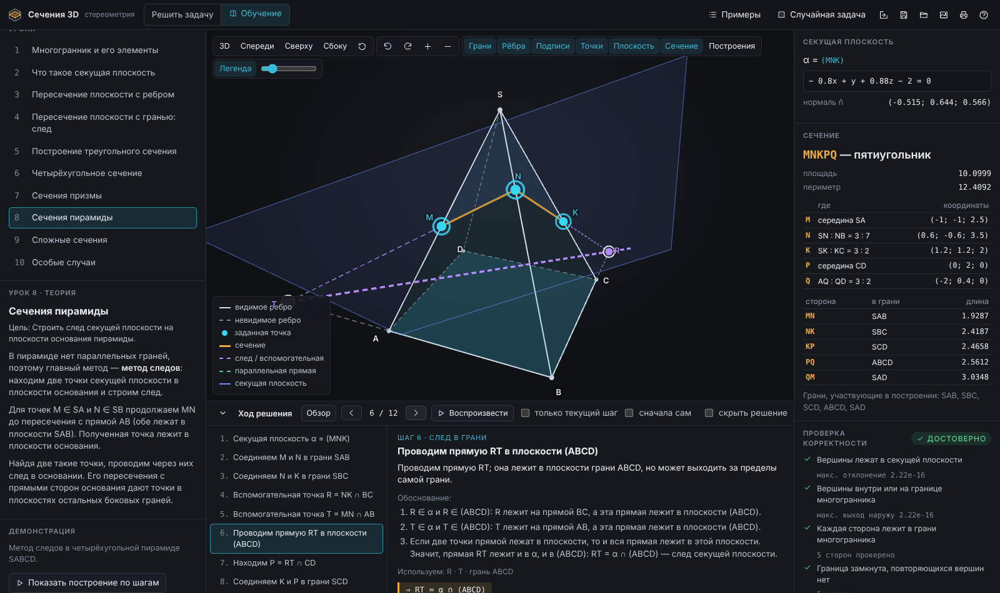

# Сечения 3D

[](https://github.com/Fegke12/sechenia-3d/actions/workflows/deploy.yml)
[](https://fegke12.github.io/sechenia-3d/)


**Интерактивный конструктор сечений многогранников для уроков стереометрии.**
Задаёшь три точки — получаешь сечение на 3D-модели и полное школьное решение: что
построить, почему это можно сделать (аксиома или теорема) и что получилось.

### 👉 [Открыть сайт: fegke12.github.io/sechenia-3d](https://fegke12.github.io/sechenia-3d/)

Ничего устанавливать не нужно — работает в любом современном браузере на компьютере.



---

## Содержание

- [Для учеников и учителей](#для-учеников-и-учителей)
- [Что умеет](#что-умеет)
- [Как это работает](#как-это-работает)
- [Для разработчиков](#для-разработчиков)
- [Документация](#документация)

---

## Для учеников и учителей

**Как решить задачу за минуту**

1. Слева выбери фигуру: куб, призму, пирамиду, тетраэдр…
2. Задай три точки — щелчком по рёбрам модели или записью из учебника:
   ```
   M ∈ AB, AM : MB = 2 : 1
   N — середина CC₁
   K ∈ A₁D₁, A₁K : KD₁ = 1 : 3
   ```
3. Сечение построится само. Внизу — «Ход решения»: листай шаги стрелками ← →,
   на модели подсвечивается то, что строится на этом шаге.

**Как учиться, а не списывать**

- **«сначала сам»** — каждый шаг сначала показывает только вопрос, ответ открывается по кнопке;
- **«Найти вершины самостоятельно»** — сечение прячется, ты отмечаешь его вершины на модели,
  программа проверяет и объясняет ошибки («вершины B и C лежат по одну сторону от плоскости —
  ребро не пересекается»);
- **режим «Обучение»** — 10 уроков от «что такое грань» до сложных сечений, в каждом теория,
  демонстрация и упражнение с проверкой.

**Учителю**

- «Случайная задача» генерирует корректную задачу с «красивыми» отношениями;
- ссылка из адресной строки сохраняет построение — можно отправить классу;
- построение сохраняется в файл, модель — в PNG, решение печатается.



---

## Что умеет

| | |
|---|---|
| **Фигуры** | куб, параллелепипед (прямоугольный и наклонный), призма 3–12-угольная (прямая и наклонная), пирамида 3–12-угольная (правильная и со смещённой вершиной), тетраэдр (правильный и произвольный), октаэдр, додекаэдр, икосаэдр |
| **Ввод точек** | щелчком по вершине, ребру или грани с привязкой к ½, ⅓, ¼…; школьной записью; формой без набора текста; точку можно двигать ползунком |
| **Результат** | многоугольник сечения, уравнение плоскости, где лежит каждая вершина и в каком отношении делит ребро, длины сторон, площадь, периметр, вид многоугольника |
| **Особые случаи** | плоскость совпадает с гранью, касается по ребру или в вершине, не пересекает фигуру; совпадающие и лежащие на одной прямой точки — с понятным объяснением |
| **Решение** | метод следов, вспомогательные точки на продолжениях рёбер, параллельность граней, параллельность прямой и плоскости, внутреннее проектирование; автовоспроизведение |
| **Проверка** | каждое сечение пересчитывается вторым независимым алгоритмом; каждое утверждение решения проверяется вычислением |

---

## Как это работает

Главный принцип — **математика важнее картинки**. Ничего не «рисуется на глаз»:

1. По трём точкам считается плоскость `n = (P₂ − P₁) × (P₃ − P₁)`.
2. Для каждой вершины — знак `n̂·V + d`: по одну сторону, по другую или на плоскости.
3. Каждая грань пересекается с плоскостью по своему циклу вершин; точки на рёбрах —
   `t = d_A / (d_A − d_B)`.
4. Отрезки из граней собираются в замкнутый многоугольник.
5. Результат проверяется: все вершины в плоскости и внутри тела, стороны в гранях,
   многоугольник выпуклый — и совпадает с ответом другого алгоритма (пересечение всех рёбер
   + выпуклая оболочка). Не прошло проверку — на экран не попадает.

Школьное решение генерируется не из шаблона, а **моделированием построения на бумаге**:
программа знает, какие точки уже найдены и в плоскостях каких граней они лежат, и на каждом
шаге применяет подходящее правило (две точки в грани → след; след ∩ прямая ребра → новая
точка; параллельные грани → параллельные следы…). Если ни одно школьное правило не подходит,
используется координатный метод — и это честно написано в шаге.

Подробно: [docs/MATHEMATICS.md](docs/MATHEMATICS.md).

---

## Для разработчиков

### Стек

React 18 · TypeScript (strict) · Vite 6 · Three.js (OrbitControls, Line2, CSS2DRenderer) ·
zustand · Vitest + fast-check · Playwright · ESLint · Prettier

### Запуск

Нужен Node.js 20+.

```bash
git clone https://github.com/Fegke12/sechenia-3d.git
cd sechenia-3d
npm install
npm run dev            # http://localhost:5173
```

| Команда | Что делает |
|---|---|
| `npm run dev` | dev-сервер с hot reload |
| `npm run build` | production-сборка в `dist/` (статический сайт, `base: './'`) |
| `npm run preview` | просмотр сборки на http://localhost:4173 |
| `npm test` | модульные тесты ядра (Vitest) |
| `npm run test:e2e` | браузерные сценарии (Playwright; впервые: `npx playwright install chromium`) |
| `npm run typecheck` | проверка типов |
| `npm run lint` / `npm run format` | ESLint / Prettier |

### Структура

```
src/
  core/                 математика — чистый TypeScript, без React и DOM
    geometry/           векторы, плоскости, пересечения, допуски, 2D-оболочка
    polyhedra/          единая модель многогранника + фабрики всех фигур + валидатор
    section/            точки (PointSpec), алгоритм сечения, подписи
    validation/         независимая проверка результата
    construction/       генератор школьного решения и проверка каждого шага
    problem/            парсер школьной записи, сериализация, примеры, генератор задач
    exercises/          проверка ответов ученика
    solve.ts            конвейер: точки → плоскость → сечение → проверки → решение
  scene/                Three.js: сцена, выбор точек (raycasting), экспорт PNG
  state/                zustand-store и мемоизированные производные данные
  lessons/              10 уроков
  components/           интерфейс
tests/unit/             Vitest + property-based (fast-check)
tests/e2e/              Playwright
docs/                   архитектура, математика, тесты, инструкция, ограничения
```

Ядро можно использовать отдельно от интерфейса:

```ts
import { createPolyhedron } from './src/core/polyhedra/catalog';
import { parseProblemText } from './src/core/problem/parse';
import { solve } from './src/core/solve';

const cube = createPolyhedron('cube', { a: 4 });
const { points } = parseProblemText('M — середина AB\nN — середина CC₁\nK — середина A₁D₁', cube);
const s = solve(cube, points.map((p, i) => ({ id: String(i), ...p })));

s.section?.status;               // 'polygon'
s.measures?.area;                // 20.7846… (правильный шестиугольник)
s.construction?.steps.length;    // шаги школьного решения
s.trusted;                       // true — все проверки пройдены
```

### Как добавить многогранник

1. В `src/core/polyhedra/catalog.ts` напиши фабрику: вершины, подписи и грани (или
   `hullFaces` для выпуклой оболочки) → `buildPolyhedron(...)`.
2. Если у фигуры есть параллельные грани/рёбра, передай `parallelReason` /
   `edgeParallelReason` со **школьным обоснованием** — без него правило параллельности не
   применяется.
3. Добавь запись в `KINDS` с параметрами для интерфейса.
4. Добавь строку в таблицу `COUNTS` в `tests/unit/polyhedra.test.ts` — валидатор проверит
   Эйлера, ориентацию и выпуклость, а property-тесты прогонят случайные сечения.

### Тесты

- **151 модульный:** 16 аналитических сценариев (квадрат, правильный шестиугольник, Менелай
  в тетраэдре…), 23 граничных случая, property-based: тысячи случайных плоскостей и задач на
  каждый прогон;
- **15 браузерных:** клики по модели, ввод условий, ошибки, смена фигур, уроки, ссылки,
  раскладка на разных экранах, отсутствие ошибок в консоли.

На каждый push в `main` GitHub Actions гоняет типы, линтер, тесты и деплоит сайт на Pages
(`.github/workflows/deploy.yml`).

---

## Документация

- [Архитектура](docs/ARCHITECTURE.md)
- [Математика и алгоритмы](docs/MATHEMATICS.md)
- [Тестирование](docs/TESTING.md)
- [Инструкция пользователя](docs/USER_GUIDE.md)
- [Известные ограничения](docs/LIMITATIONS.md)

## Лицензия

[MIT](LICENSE) © Виталий Реннер
